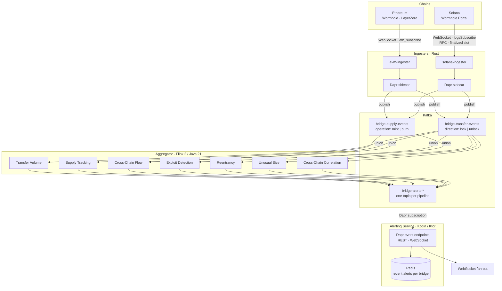

# Architecture

Real-time cross-chain bridge exploit detection across Ethereum and Solana.

## System Overview

## Event-to-Alert Mapping

| Pipeline                | Input    | Key                         | Window                             | Alert topic                             |
|-------------------------|----------|-----------------------------|------------------------------------|-----------------------------------------|
| Transfer Volume         | transfer | `bridgeAddress:chain`       | 5-min tumbling                     | `bridge-alerts-transfer-volume`         |
| Supply Tracking         | supply   | `bridgeAddress:chain`       | 5-min tumbling                     | `bridge-alerts-supply-tracking`         |
| Cross-Chain Flow        | union    | `bridgeAddress`             | 5-min tumbling                     | `bridge-alerts-cross-chain-flow`        |
| Exploit Detection       | union    | `bridgeAddress:chain`       | 60-s session                       | `bridge-alerts-exploit-detection`       |
| Reentrancy              | transfer | `transactionHash`           | 5-s tumbling                       | `bridge-alerts-reentrancy`              |
| Unusual Size            | transfer | `bridgeAddress:chain:token` | 5-min tumbling                     | `bridge-alerts-unusual-size`            |
| Cross-Chain Correlation | transfer | `messageHash`               | session, `CORRELATION_GAP_SECONDS` | `bridge-alerts-cross-chain-correlation` |

Every key is a serialized String, so `(chain, bridgeAddress)` is a composite key made of two fields,
not a Flink tuple. A malformed envelope is counted and dropped rather than routed onward; the DLQ
topic exists but has no consumer (`GAPS.md`).

Cross-Chain Flow is the one pipeline keyed on the bridge alone: it exists to compare chains, so
scoping it per chain would defeat it. Its alert schema carries no `chain` field. Cross-chain alerts
are stored under the literal chain segment `cross-chain` for the same reason.

## Design Decisions

### Chain-Agnostic Bridge Identity

Bridges are identified by `(chain, bridgeAddress)`; a contract address alone is ambiguous across
chains. `chain` is CAIP-2 (`eip155:1`, `solana:5eykt...`), `chainName` is the display form.

**Why Solana**: it forces the abstraction to handle non-EIP-155 chain IDs and a finality model that
is not confirmation counting. If the pipeline only ever saw EVM, "chain-neutral" would be an
untested claim.

### Two Event Topics, One Record Each

`BridgeTransferEvent` (`bridge-transfer-events`, 7-day retention) and `BridgeSupplyEvent`
(`bridge-supply-events`, 30-day retention) carry enum discriminants — `direction` = lock/unlock,
`operation` = mint/burn — rather than four record types. A new direction is therefore a compile error
at every switch that misses it, where a sealed-union-of-records design silently swallowed new
subtypes through a `default` branch.

The split gives independent retention (value transfers are replayed for correlation; supply changes
are kept longer for audit) and lets consumers subscribe only to what they need. The two record shapes
genuinely differ, so the `BridgeActivity` union feeding the cross-chain pipelines is a real
normalization, not two names for one payload.

Three field assumptions that outlive any schema edit:

- **`blockTimestamp` is seconds, `eventTimestamp` is milliseconds.** The latter is ingester capture
  time, not chain time.
- **`gasUsed`/`gasPrice` are chain-neutral slots.** On Solana the transaction fee goes in `gasUsed`
  with `gasPrice` fixed at `"0"`.
- **Ordering is `logIndex` within a transaction and watermarks across them.** Window results derive
  from `windowEnd` plus the configured duration, so `windowStart` is never authoritative on its own.

### Protocol Type Safety

`protocol` is an Avro enum, validated at config load, again on schema decode (an unknown symbol
fails), and by the Flink type system thereafter. No string comparisons in the hot path. The schema
declares `wormhole`, `layerzero` and a reserved `hop`; only the first two have decoders.

### Finality

**EVM** — depth-based. Events buffer until the chain head is 12 blocks past them, with a
deduplication cache; handles reorgs up to 12 blocks deep. No polling task needed.

**Solana** — external. A separate task polls the finalized slot every `FINALITY_POLL_INTERVAL_SECS`
and the buffer releases events once their block reaches it. Cluster finality is authoritative, so
there is no confirmation counting.

Both use the same `FinalityBuffer` from `common/` with `Depth` and `External` modes.

### Dapr for Pub/Sub, Native Connectors for Flink

Ingesters publish through their Dapr sidecar, which owns the Kafka producer, retries, and CloudEvent
wrapping. The alerting service subscribes through Dapr (`/dapr/subscribe` plus the declarative
subscriptions in `dapr/subscriptions/`), so consumer-group and offset management stay out of the app.

Flink bypasses Dapr: it needs checkpoint-coupled consumer offsets, event-time watermarks and
backpressure, which an HTTP pub/sub abstraction cannot provide. Watermark is bounded out-of-orderness
at 5 s by default (`WATERMARK_DELAY_SECONDS`).

### Alert Delivery Is At-Least-Once

Sinks use `DeliveryGuarantee.AT_LEAST_ONCE`, not exactly-once: two-phase-commit sinks require Kafka
transaction support and idle-transaction timeouts, and at-least-once keeps a failing sink from holding
back checkpoints indefinitely. The consequence is explicit — a restart can replay a window and emit
the same alert twice.

That is handled once, in the alerting service: an alert is classified `Fresh` or `Replay` against
what Redis already holds for its `windowEnd`, and only a `Fresh` one is stored and broadcast. Redis
writes use `ZADD ... GT` so a replayed window cannot overwrite a newer entry.

Checkpointing and restart policy are bounded, so a permanently failing sink ends as a failed job
rather than an endless loop.

### TriState Field-Level Merge

`TriState<T>` distinguishes three enrichment outcomes: `Undefined` (not seen), `Defined(value)`, and
`Null` (enrichment failed). Merge keeps the first `Defined` value and propagates `Null`, so a
transport failure is never silently mistaken for "no data".

### Severity Thresholds

Computed in `AlertSeverity`, calibrated for demo-level activity. Amounts reach the aggregator at
18-decimal fixed point (`common/src/amount.rs`), so thresholds are compared as raw `BigInteger` units.

| Alert | LOW → CRITICAL |
|---|---|
| Transfer Volume | total ≥ 10k → > 1M |
| Supply Tracking | any burn-only window (mints = 0) is CRITICAL; else abs(netMinted) ≥ 5k → > 500k |
| Cross-Chain Flow | imbalance ratio ≥ 0.15 → > 0.5 |
| Exploit Detection | 1 pattern → > 2 patterns |
| Reentrancy | 2 calls → > 5 calls |

### Exploit Detection Patterns

Session window (60-s gap), evaluated per `(bridge, chain)`:

1. **RAPID_TRANSFERS** — more than 10 events in one session
2. **LARGE_TRANSFER** — a single transfer above the threshold
3. **SUPPLY_MISMATCH** — netLocked vs netMinted differ by more than 10%

The remaining patterns run in their own pipelines with their own alert types, not in this function:
`UNUSUAL_SIZE` (>3 stddev via Welford's algorithm, per token) and cross-chain correlation (session
window keyed on `message_hash`). New-address detection is intentionally not implemented — it needs
external or unbounded state and does not justify the complexity.

## Known Limitations

Accepted limitations, open defects, and test coverage gaps live in `GAPS.md`. Schemas are the single
source of truth in `schemas/*.avsc`, code-generated for both the JVM and Rust builds.
